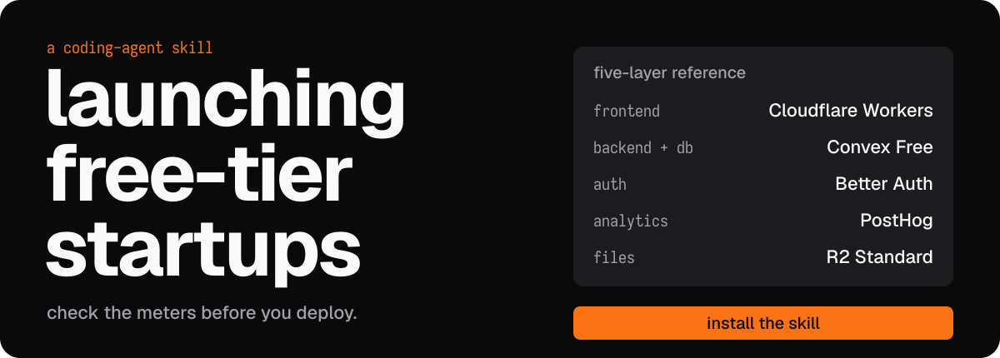

<div align="center">

<a href="#install"></a>

<p>
<a href="https://github.com/ubranch/launching-free-tier-startups/actions/workflows/check.yml"></a>
<a href="https://skills.sh/ubranch/launching-free-tier-startups"></a>
<a href="./LICENSE"></a>
</p>

</div>

**launching-free-tier-startups** is a coding-agent skill, not a starter app. It helps you choose a five-layer stack, check runtime fit and billing limits, then implement one working path. Free allowances do not guarantee a $0 bill.

## install

```bash
npx skills add ubranch/launching-free-tier-startups --skill launching-free-tier-startups -g
```

Requires Node.js/npm for `npx`. Select your target agent when prompted. Use an agent supported by the [skills CLI](https://skills.sh/docs/cli); this repository does not claim a built-in OMP install target.

Then ask your agent:

```text
Use launching-free-tier-startups for a small SaaS with login,
live updates, activation analytics and user uploads.
Reuse working services. Check current quotas, runtime adapters
and spending controls before implementing one end-to-end path.
Ask before purchases or billing changes.
```

Read the complete [skill](./skills/launching-free-tier-startups/SKILL.md) before letting an agent provision services.

## five layers

Evaluate this as a coherent starting point for a new TypeScript MVP, not a migration mandate or five services every app must add.

1. <a href="https://developers.cloudflare.com/workers/"></a> **Frontend: Cloudflare Workers static assets.** Keep Pages for an existing Pages app. Direct static serving is free; SSR and Functions consume compute quotas. Check the framework adapter and Workers runtime before changing hosts.
2. <a href="https://docs.convex.dev/"></a> **Backend and database: Convex Free.** TypeScript functions and reactive queries cover the API, database and live updates. Subscription updates count toward calls; limits generally apply across the team. Starter permits paid overages.
3. <a href="https://better-auth.com/docs/integrations/convex"></a> **Authentication: Better Auth.** A free open-source framework, not a managed auth service. Convex needs its official component, adapter, routes and client/session setup. Hosting, email and SMS are separate costs.
4. <a href="https://posthog.com/docs"></a> **Analytics: PostHog.** Measure a real activation funnel. Enable only needed products, obtain consent where required, and mask sensitive inputs, page content and event properties before capture.
5. <a href="https://developers.cloudflare.com/r2/"></a> **Files: Cloudflare R2 Standard.** Keep user objects private. An authenticated server signs short-lived access only after checking ownership. Free internet egress does not make storage, operations or an attached Worker free.

The installed [service playbook](./skills/launching-free-tier-startups/references/service-playbook.md) gives coding agents a separate implementation path and completion checks for each layer.

Logos identify the services discussed here; they do not imply affiliation or endorsement. Third-party artwork and trademarks have their own terms, separate from this repository's MIT license.

## free allowances

Checked **2026-10-07**. These five rows are a snapshot, not an exhaustive plan specification. Recheck official sources and the actual account plan before deployment.

| Service | Included free allowance | Other meters and limits |
|---|---|---|
| [Cloudflare Workers / Pages](https://developers.cloudflare.com/workers/platform/pricing/) | Direct static requests: free and unlimited. Workers Free: 100,000 dynamic requests/day and 10 ms CPU/invocation. [Pages](https://developers.cloudflare.com/pages/platform/limits/): 500 builds/month. | SSR and Pages Functions use Workers quotas. Worker-first routing or Workers Caching can meter otherwise static requests. Builds, asset limits and additional Cloudflare products have separate constraints. |
| [Convex Free](https://docs.convex.dev/production/state/limits) | 1M function calls/month; 20 GB-hours action compute/month; 0.5 GB database; 1 GB database I/O/month; 1 GB file storage; 1 GB file egress/month. | Generally shared per team. Calls include subscription updates, scheduled executions and file accesses. Indexes use database storage; search and deployment limits also apply. Free has resource caps; Starter allows paid overages. |
| [Better Auth](https://better-auth.com/docs/integrations/convex) | Free open-source auth framework; no managed-hosting or monthly-active-user allowance is supplied by the framework. | Sessions and user records use the backend's resources. Budget OAuth-provider requirements, transactional email, SMS, hosting and maintenance separately. |
| [PostHog](https://posthog.com/pricing) | 1M product analytics events/month and 5,000 session recordings/month. | Flags, errors and other products/add-ons have independent meters. The no-card Free plan stops at limits; paid accounts need a saved limit for each enabled product. Data rejected at a limit is lost, not queued. |
| [Cloudflare R2 Standard](https://developers.cloudflare.com/r2/pricing/) | 10 GB-month storage; 1M Class A and 10M Class B operations/month; free direct internet egress. | Writes/listing/multipart operations count as Class A; reads/metadata as Class B. The free tier does not apply to Infrequent Access. Attached services can charge; no account-wide R2 hard spending cap is established here. |

Include domains, email/SMS, payment processing and other external costs in the budget. Alerts are not spending caps. An agent must obtain authorization before purchases, account setup or billing changes.

## choosing a stack

Reuse existing working services unless a measured limitation justifies migration. Vercel and Netlify are normal frontend choices and have free offerings of their own; their framework support, commercial-use terms and quotas can differ. A Workers deployment is not an unchanged Node.js server: native dependencies, filesystem assumptions and SSR features need a compatible deployment path.

Supabase fits PostgreSQL, SQL tooling and an existing relational model. Convex fits app functions and reactive queries, but replacing SQL/API code still takes work. Clerk or Auth0 can supply managed authentication rather than app-owned Better Auth code. Mixpanel or Amplitude may already cover the analytics you need. AWS S3 can be preferable when required AWS integrations or S3 features are unavailable in R2. None of these choices automatically requires a paid subscription.

A migration must account for data export/import, ownership IDs, active sessions, OAuth callbacks, event definitions and storage API compatibility. For a new MVP, avoid assembling a separate API server, database and realtime transport when Convex already meets the requirements. For an existing app, do not replace a functioning integration merely to match this list.

## paid alternatives and a spend example

Checked **2026-10-07**, in USD before tax. These are optional plan choices, not equivalent bundles or a claim that people or coding agents always buy paid plans.

| Layer | Named alternative | Price, billing and practical difference |
|---|---|---|
| Frontend | [Vercel Pro](https://vercel.com/pricing) | $20/month platform fee, including one deploying seat and a $20 infrastructure-usage credit. Extra deploying seats cost $20/month each; usage beyond credit and add-ons can change the bill. Managed deployments, CDN and HTTPS may avoid framework adaptation work. [Hobby is free for personal/non-commercial use](https://vercel.com/docs/plans/pro-plan). |
| Backend/database | [Supabase Pro](https://supabase.com/pricing) | $25/month base, with a $10/month organization-wide compute credit covering one Micro project; hourly compute and quota overages can add charges. Managed PostgreSQL, APIs, auth, storage and daily backups differ from Convex's function/reactive-query model. [Compute credit is not per project](https://supabase.com/docs/guides/platform/manage-your-usage/compute). A Free plan also exists. |
| Authentication | [Clerk Pro](https://clerk.com/pricing) | $25/month on monthly billing; $20/month is the annual-billing equivalent. Includes 50,000 monthly retained users (MRU) per app, then first-tier overage is $0.02/MRU/month. Hosted auth and paid features can justify it; Hobby is free through 50,000 MRU. SMS/SSO add-ons can cost extra. MRU is not the same meter as MAU. |
| Analytics | [Amplitude Plus](https://amplitude.com/pricing) / [Mixpanel Enterprise](https://mixpanel.com/pricing/) | Amplitude Plus starts at $0 with the first 2M events/month free; paid event/MTU rates depend on the selected checkout plan, so no fixed monthly bill is asserted here. [Terms](https://amplitude.com/plus-plan-terms) allow monthly or 12-month auto-renewing commitments. Mixpanel Enterprise is sales-quoted; its Free plan includes up to 20M events and 500,000 replays/month. Compare needed analysis/replay features and actual meters, not an unverified subscription floor. |
| Object storage | [AWS S3 Standard](https://aws.amazon.com/s3/pricing/) | No minimum subscription. US East (N. Virginia), first 50 TB: $0.023/GiB-month; PUT/COPY/POST/LIST $0.005/1,000 requests and GET/other $0.0004/1,000. Direct internet transfer's first paid tier is $0.09/GB beyond AWS's [shared 100 GB/month allowance](https://aws.amazon.com/about-aws/global-infrastructure/global-network/faqs/) (not per bucket/service/region; excludes China/GovCloud). AWS integrations/S3 features can justify the choice. New-account credits are conditional and temporary. |

An **optional frontend + database subtotal is $45/month**: Vercel Pro $20 + Supabase Pro $25. This assumes one deploying seat, one Micro database project covered by Supabase's compute credit, Vercel infrastructure usage within its included credit, all included quotas respected, and no paid add-ons. Credits cover eligible usage, not the base subscription fee.

That subtotal excludes extra seats/projects/compute, quota overages, separately billed storage/requests/transfer, email/SMS, domains/renewals and taxes. Supabase Auth may already meet the requirement; adding paid Clerk is not automatically necessary. This is an illustrative plan subtotal, not a measured app invoice or a savings claim.

For a new app that fits the free stack's runtime and **all** applicable allowances, included provider usage can have no charge. A needed paid feature, unexpected traffic, upload abuse or an external service can change that. Estimate the actual workload before choosing either path.

## localhost is development, not public hosting

Running the frontend on a laptop is useful for development, offline work and private demos. A localhost frontend can still call paid cloud services; its address alone says nothing about backend costs.

For example, [Supabase's self-hosting guide](https://supabase.com/docs/guides/self-hosting) explicitly says its CLI local stack is not hardened for production and must not be exposed externally. A production self-hosted deployment is a separate operational choice, not a dev-server command made public.

| Production need | What local hosting requires |
|---|---|
| Public reachability | `localhost` is reachable only on the same device. LAN access needs a listening interface and firewall rules; public access needs a reachable address plus router/NAT configuration or a tunnel. Carrier-grade NAT may prevent inbound port forwarding. |
| HTTPS and authentication | A public hostname, TLS termination and certificate renewal. Configure actual trusted origins, CORS and OAuth redirect URLs; a development callback is not automatically valid in production. A tunnel supplies reachability/TLS, not your app's authorization. |
| Availability and recovery | Keep the machine, power and network online; handle sleep/reboots, security updates and monitoring. Back up persistent data off the host and prove that it restores. |
| Backend integration | Keep API, database and realtime connections working together, whether native processes or containers. Maintain schema changes, secrets, object storage and email delivery; a running frontend dev server does not supply them. |

Self-hosting remains valid when control, offline operation, data residency or compliance requirements justify that work. Owned hardware has electricity, replacement and operational costs; a rented server has a rental bill too. Neither is equivalent to a managed free allowance, and managed hosting does not remove app-level security, backup or recovery responsibilities.

The skill asks the agent to exercise login, an authorized mutation, a reactive update in a second client, activation measurement and file upload/read when needed. It must report measured quota headroom, remaining costs and untested integrations. This repository supplies guidance, not a pretested deployment or a guarantee of provider compatibility.

## install counts and privacy

The standard skills CLI sends installation telemetry used by skills.sh to aggregate install counts. This repository adds no custom telemetry or app tracker.

To opt out, set `DISABLE_TELEMETRY=1` or `DO_NOT_TRACK=1` in your environment before installing. Keep your chosen opt-out in place; telemetry is not required to use the skill. See the [CLI telemetry documentation](https://skills.sh/docs/cli#telemetry).

Discovery and badge counts can lag. Install counts are not unique or active users; opt-out and CI installs must not be treated as evidence of user adoption.

## reference

<details>
<summary><b>sources and agent selection</b></summary>

### sources

The five-layer reference comes from the [original video and caption](https://www.instagram.com/p/DeHYCIpColc/): frontend 00:11, backend 00:30, auth 00:54, analytics 01:16 and storage 01:40. The skill adds implementation and billing safeguards rather than treating the video's launch-before-scale advice as a cost guarantee.

Official references:

- [Pages limits](https://developers.cloudflare.com/pages/platform/limits/), [Workers pricing](https://developers.cloudflare.com/workers/platform/pricing/) and [static asset billing](https://developers.cloudflare.com/workers/static-assets/billing-and-limitations/)
- [Convex pricing](https://www.convex.dev/pricing) and [usage accounting](https://docs.convex.dev/production/state/limits)
- [Better Auth's Convex integration](https://better-auth.com/docs/integrations/convex)
- [PostHog pricing](https://posthog.com/pricing), [privacy controls](https://posthog.com/docs/privacy/data-collection) and [billing controls](https://posthog.com/docs/billing/limits-alerts)
- [R2 pricing](https://developers.cloudflare.com/r2/pricing/) and [presigned access](https://developers.cloudflare.com/r2/api/s3/presigned-urls/)

### agent selection

For a noninteractive Claude Code installation:

```bash
npx skills add ubranch/launching-free-tier-startups --skill launching-free-tier-startups -g -a claude-code -y
```

CLI syntax is based on skills 1.7.1. Other agents may discover or invoke installed skills differently; follow your agent's skill documentation. Installing this skill does not install its recommended infrastructure or authorize billing changes.

</details>

## maintain

Edit [SKILL.md](./skills/launching-free-tier-startups/SKILL.md) and its [service playbook](./skills/launching-free-tier-startups/references/service-playbook.md), keep the README's allowance/comparison dates and official sources current, then run the repository check:

```bash
bun scripts/check.ts
```

Bun is for maintainer checks, not using the skill. Keep credentials, private transcripts and local configuration out of contributions.

<details>
<summary><b>banner typography and regeneration</b></summary>

Edit [hero.source.svg](./assets/readme/hero.source.svg), the accessible text source. The banner uses Geist Bold (700) for the title, Geist Medium (500) for body text, reference heading and install CTA, and ZedMono Regular (400) for the eyebrow and row labels.

The published artwork uses ZedMono Nerd Font Mono Regular for its ASCII labels, a ZedMono-derived face rather than a generic monospace fallback. The generator also accepts upstream ZedMono Regular.

Get the exact faces from the official [Geist fonts](https://github.com/vercel/geist-font) and [Zed fonts](https://github.com/zed-industries/zed-fonts). No fonts are bundled. Regenerate the published [hero.svg](./assets/readme/hero.svg) as outlined glyphs with local font paths:

```bash
uv run scripts/outline_hero.py \
  --geist-bold "/path/to/Geist-Bold.ttf" \
  --geist-medium "/path/to/Geist-Medium.ttf" \
  --zed-mono "/path/to/ZedMono-Regular.ttf"
```

Replace these illustrative paths with your own. UV and the script's pinned fonttools/uharfbuzz dependencies are build-only; none are needed to install or use the skill.

</details>

## license

[MIT](./LICENSE), copyright 2026 [ubranch](https://github.com/ubranch). Provider services, logo artwork and trademarks have their own terms. Cloudflare's marks are subject to its [trademark policy](https://www.cloudflare.com/trademark/); this repository does not assert trademark permission or clearance.

<details>
<summary><b>logo sources and terms</b></summary>

- The [Cloudflare](https://raw.githubusercontent.com/simple-icons/simple-icons/develop/icons/cloudflare.svg) and [Better Auth](https://raw.githubusercontent.com/simple-icons/simple-icons/develop/icons/betterauth.svg) geometry comes from Simple Icons under [CC0](https://github.com/simple-icons/simple-icons/blob/develop/LICENSE.md). Its [disclaimer](https://github.com/simple-icons/simple-icons/blob/develop/DISCLAIMER.md) leaves vendor and trademark rights separate.
- The unchanged three-color Convex symbol is isolated from [Convex's official logo](https://www.convex.dev/_next/static/immutable/media/logoColor.1mhf6z9arpiev.svg), linked from its [brand assets](https://www.convex.dev/brand). No permissive logo-art license is asserted here.
- The unmodified current PostHog logomark comes from [official source geometry](https://github.com/PostHog/brand/blob/021dac62310428333ae2b8c20f23e272057c05ba/src/logo/geometry.ts); its [logo-use guidance](https://posthog.com/handbook/brand/assets) applies. The brand source has a [PolyForm Strict license](https://github.com/PostHog/brand/blob/021dac62310428333ae2b8c20f23e272057c05ba/LICENSE), not this project's MIT license or CC0.
- The R2 glyph comes from [Cloudflare Docs' `r2.svg`](https://github.com/cloudflare/cloudflare-docs/blob/production/src/icons/r2.svg), attributed to Cloudflare under [CC BY 4.0](https://creativecommons.org/licenses/by/4.0/) and its [content license notice](https://github.com/cloudflare/cloudflare-docs/blob/production/README.md#license-and-legal-notices). The tile adds padding/scaling and renders the uncolored source geometry white. Cloudflare trademark terms still apply.

</details>
